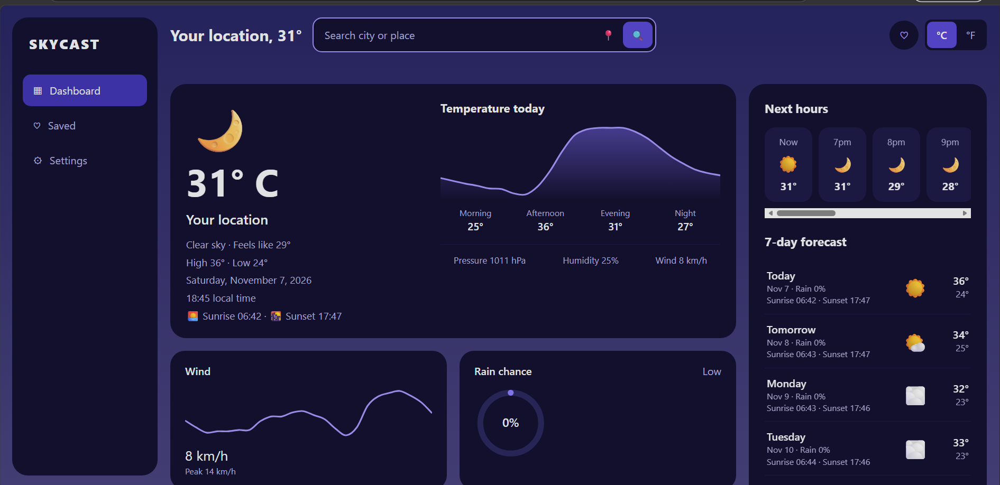
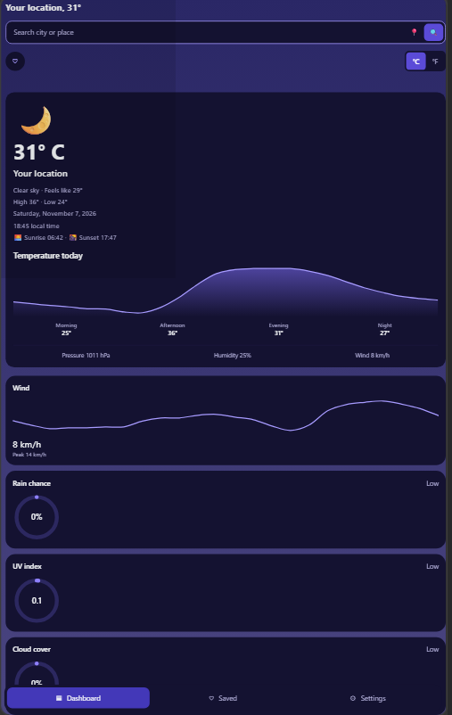

# SkyCast 2.0

SkyCast is a responsive weather dashboard. Search any city or use your location to see current conditions, an hourly outlook, a 7-day forecast, and sunrise/sunset times. A small Express server sits between the browser and the [Open-Meteo](https://open-meteo.com/) API, adding validation, caching, and rate limiting. No API key is needed.

## Screenshots




```

## Features

- Current conditions: temperature, feels-like, humidity, pressure, wind, cloud cover, UV index
- Hourly forecast (next 12 hours) and 7-day forecast with sunrise and sunset
- City search and browser geolocation, with specific messages for each permission error
- Separate temperature (°C/°F) and wind-speed (km/h or mph) settings
- Saved locations, validated and de-duplicated, stored in the browser
- Loading indicator, automatic retry, and a "Try again" button on failures
- Accessible: labelled controls, keyboard navigation, skip link, ARIA attributes, screen-reader chart descriptions
- Responsive layout with sidebar on desktop and bottom navigation on mobile

## Technology stack

Node.js 18+, Express 4, vanilla JavaScript (ES modules), SVG charts, CSS grid and flexbox, Node's built-in test runner. The only runtime dependency is Express.

## Project structure

```
server.js              Entry point: reads config, starts the server
src/
  app.js               Express app factory (routes, headers, error handling)
  config.js            Environment variable parsing
  cache.js             TTL cache: size limit, request de-duplication, stale fallback
  rateLimit.js         Per-IP rate limiter
  validation.js        Query validation and sanitising
  weatherService.js    Open-Meteo client with timeouts
public/
  index.html           Page structure
  style.css            Styles
  js/                  Frontend modules (app, units, storage, format, charts, weatherCodes)
test/                  Automated tests
docs/screenshots/      Screenshots go here
render.yaml            Render deployment blueprint
.env.example           Documented environment variables
```

## Installation

```bash
git clone <your-repository-url>
cd skycast
npm install
```

## Running locally

```bash
npm start        # http://localhost:3000
npm run dev      # restarts automatically when files change
```

## Environment variables

All are optional. Copy `.env.example` to `.env` for reference; on Node 20.6+ you can load it with `node --env-file=.env server.js`.

| Variable | Default | Purpose |
| --- | --- | --- |
| `PORT` | `3000` | Port to listen on (hosts like Render set this automatically) |
| `NODE_ENV` | `development` | Set to `production` when deployed |
| `CACHE_TTL_MS` | `600000` | How long weather data is cached |
| `CACHE_MAX_ENTRIES` | `500` | Maximum cached items (oldest evicted first) |
| `RATE_LIMIT_MAX` | `60` | Requests allowed per window per IP |
| `RATE_LIMIT_WINDOW_MS` | `60000` | Rate-limit window |
| `UPSTREAM_TIMEOUT_MS` | `8000` | Timeout for Open-Meteo requests |
| `TRUST_PROXY` | `1` in production, off otherwise | Number of proxies in front of the app |

No secrets are required. Never commit a `.env` file (it is in `.gitignore`).

## API

| Method | Route | Description |
| --- | --- | --- |
| GET | `/api/weather?city=Paris` | Weather for a city (2 to 100 characters) |
| GET | `/api/weather?lat=48.85&lon=2.35` | Weather for coordinates; optional `name` and `country` for display |
| GET | `/api/health` | Health check |

Errors are JSON, `{ "error": "message" }`, with status 400 (invalid input), 404 (unknown place), 429 (rate limited), 502 (weather service failed), 504 (weather service timed out) or 500.

## Testing

```bash
npm test
```

Tests use Node's built-in runner and a fake weather service, so they need no network access. They cover the API endpoints, input validation, upstream failures, caching, rate limiting, unit conversion, weather codes, date handling, and saved-location validation.

## Deploying to Render

1. Push the project to a GitHub repository.
2. In Render, choose **New → Blueprint** and select the repository. Render reads `render.yaml`.
3. Approve the plan. Render runs `npm install --omit=dev`, then `npm start`, and checks `/api/health`.
4. When the deploy finishes, open the URL Render shows. Add it to this README and your repository's website field.

On the free plan the service sleeps when idle, so the first request after a pause can take about 30 seconds.

## Known limitations

- The cache and rate limiter are in memory. They reset on restart and are not shared between multiple instances (a shared store such as Redis would fix this).
- Saved locations live in the browser's local storage, so they do not sync across devices.
- Geocoding returns only the top match for a city name, so ambiguous names (e.g. "Springfield") may resolve to an unexpected place.
- Weather icons are emoji, so their appearance varies by operating system.
- There are no browser-level (end-to-end) tests yet.

## Data source

Weather and geocoding data from [Open-Meteo](https://open-meteo.com/), which is free for non-commercial use. Please review their terms before using the app commercially.

## License

MIT. See [LICENSE](LICENSE).
